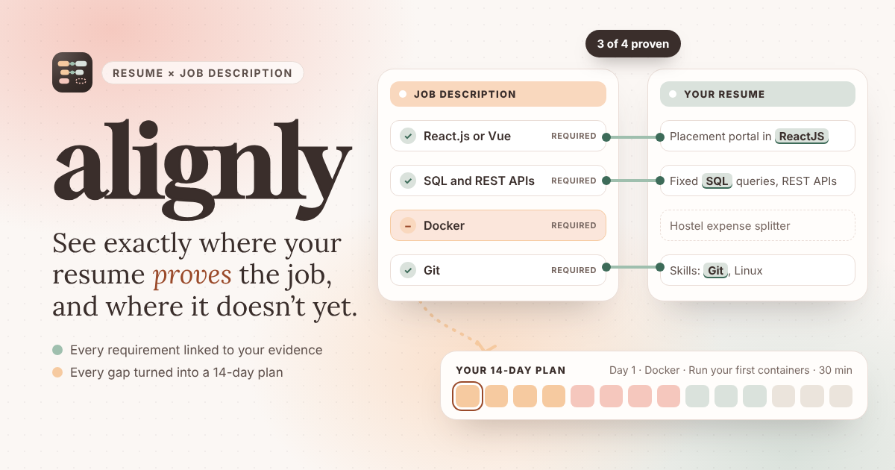
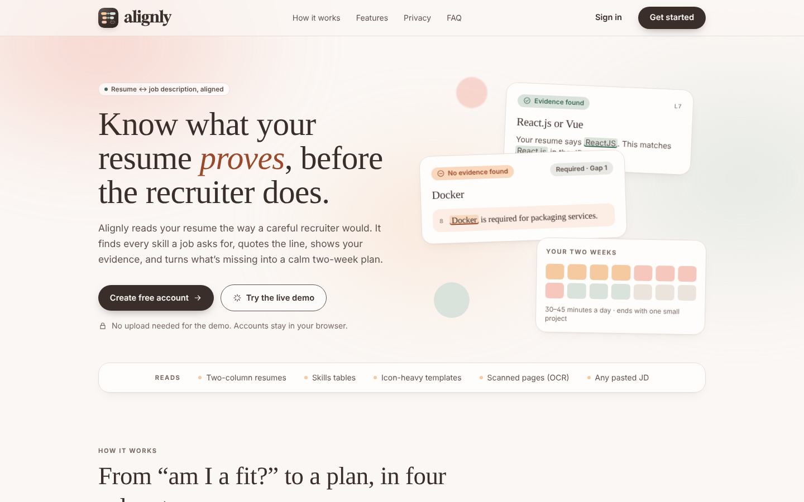
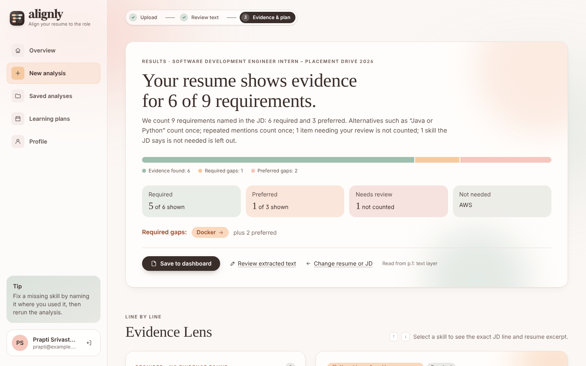
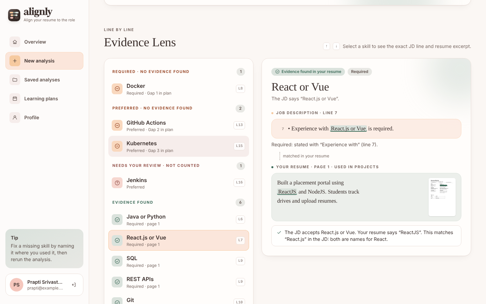
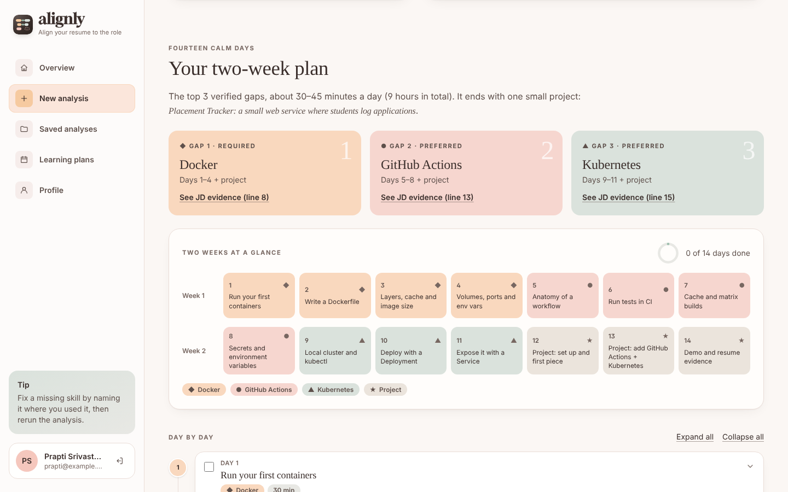
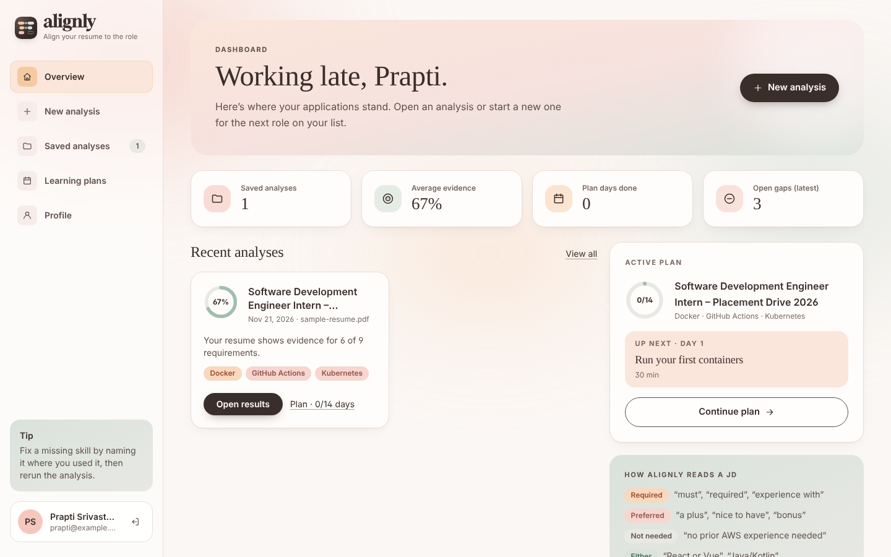
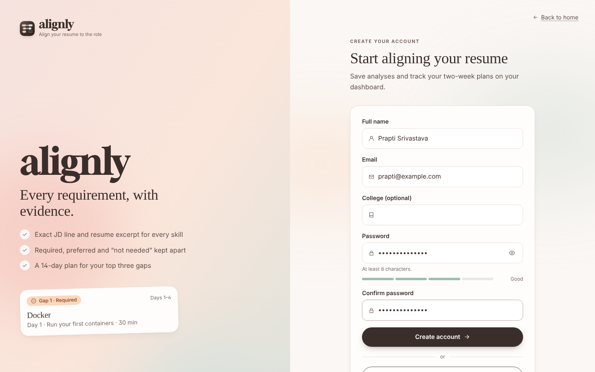
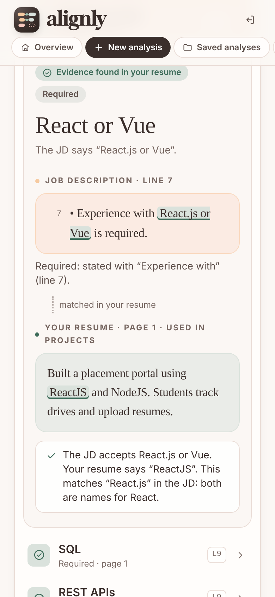

<div align="center">


# alignly

**Every requirement, with evidence.**

Alignly compares your resume with a job description. It quotes the exact line behind every skill, shows where your resume proves it, and turns what’s missing into a calm 14-day plan.


[**Features**](#-features) · [**Screenshots**](#-screenshots) · [**Quick start**](#-quick-start) · [**How it works**](#-how-it-works) · [**Accuracy**](#-accuracy-and-evaluation) · [**Privacy**](#-privacy)



</div>

---

## 💡 Why Alignly?

Students apply to placement drives without knowing which skills a role expects that their resume doesn’t yet show. Most resume checkers return a single “match score” built from keyword counts. You can’t act on a number.

**Alignly explains every verdict instead.** For each skill the job asks for, it tells you:

- **Where the JD asks for it.** You get the exact line, quoted, with its line number.
- **Where your resume proves it.** You get the excerpt and page, and whether the skill is *used* in a project or only *listed* under Skills.
- **How strongly it’s needed.** Required, preferred, “not needed”, or one of several alternatives.
- **What to do next.** A day-by-day plan for the top three gaps, 30 to 45 minutes a day.

> Built for **Code Fuzion 2026** at Lovely Professional University, problem statement **M5: Resume vs Job Description Gap Analyser**.

---

## ✨ Features

| | |
|---|---|
| 🔍 **Evidence Lens** | Pick any skill to see the highlighted JD line next to the resume excerpt that proves it. Alias matches are explained in plain words, for example: *“Your resume says ReactJS. This matches React.js in the JD.”* |
| 🧠 **Understands JD language** | Tells **required** from **preferred**, handles **negation** (“no prior AWS experience needed”) and **alternatives** (“React or Vue”, “Java/Kotlin”). If your resume shows one of the alternatives, the requirement is satisfied. |
| 🔤 **Smart skill matching** | A versioned dictionary of about 130 skills. ReactJS, React.js and react-js all match React, but **C, C++ and C#** stay separate, and **Java never matches JavaScript**. |
| 📄 **Reads real resumes** | Rebuilds the reading order of **two-column** layouts from text positions, keeps **table** rows together, strips **icon** glyphs, and runs **OCR** on scanned pages, including pages that mix scanned and typed content. |
| 🙋 **Honest by design** | Unclear items go to **Needs review** instead of being guessed. An unreadable page never turns into a list of false gaps. Missing skills are labelled *“No evidence found in your resume”*, never *“you lack this skill”*. |
| 🗓️ **14-day learning plan** | One concrete task per day, with something to produce and a self-check. Prerequisites come first (Docker before Kubernetes). The plan ends in one small project that uses every gap, or a practical checkpoint per skill when they don’t fit one project. |
| ✍️ **Correct and rerun** | Edit the extracted text, rerun, and the evidence, counts and plan all update together. |
| 🏠 **Dashboard** | Landing page, sign-in and register, saved analyses, plan progress tracking and a profile page. |
| 📱 **Accessible everywhere** | Fully keyboard-navigable (↑ ↓ through skills). Colours always come with text or icons, motion respects *reduced motion*, and the layout works on phones down to 360 px. |
| 📏 **Measurable** | A reproducible evaluation command scores missing-skill detection against a judge’s answer key. |

---

## 📸 Screenshots

<table>
  <tr>
    <td width="50%"><p align="center"><b>Landing page</b></p></td>
    <td width="50%"><p align="center"><b>Results summary</b></p></td>
  </tr>
  <tr>
    <td><p align="center"><b>Evidence Lens</b>: the JD line and your resume, side by side</p></td>
    <td><p align="center"><b>Two-week plan</b>, colour-coded by gap</p></td>
  </tr>
  <tr>
    <td><p align="center"><b>Dashboard</b>: saved analyses and the active plan</p></td>
    <td><p align="center"><b>Create account</b></p></td>
  </tr>
</table>

<p align="center"><br/><b>On mobile</b>, the evidence opens directly under the skill you tap.</p>

---

## 🚀 Quick start

**Requirements:**

- **Node.js 20+**
- For scanned resumes only: **Tesseract** and **Poppler** (free).
  - macOS: `brew install tesseract poppler`
  - Ubuntu/Debian: `sudo apt install tesseract-ocr poppler-utils`

```bash
git clone https://github.com/<your-username>/alignly.git
cd alignly
npm install
npm run build
npm start            # → http://localhost:3000
```

Click **Try the live demo** to run the whole flow with a bundled sample resume and job description.

### Other ways to run it

```bash
# Docker (OCR tools included)
docker build -t alignly . && docker run -p 3000:3000 alignly

# Browser-only build: one self-contained HTML file, nothing uploaded anywhere
npm run build:static  # → dist-static/alignly.html (works on GitHub Pages / Netlify; no OCR)
```

### 🌍 Open it anywhere, on any device

Alignly also ships as **one self-contained HTML file**. It needs no server and no install, and works offline. Your resume never leaves the device.

| Option | How |
|---|---|
| **GitHub Pages** (recommended) | This repo includes [`.github/workflows/pages.yml`](.github/workflows/pages.yml). Go to **Settings → Pages → Source: GitHub Actions** and push to `main`. Your site goes live at `https://<your-username>.github.io/alignly/` and works on phones, tablets and laptops. |
| **Netlify Drop** | Run `npm run build:static`, rename `dist-static/alignly.html` to `index.html`, and drag its folder onto [app.netlify.com/drop](https://app.netlify.com/drop). |
| **Just the file** | Open `alignly.html` in any modern browser (Chrome, Edge, Firefox or Safari), from your computer or your phone’s Files app. |

The browser-only version reads PDFs with selectable text. For scanned pages, it asks you to paste their text, because OCR needs the server version.

### Commands

| Command | What it does |
|---|---|
| `npm run build` | Bundles the client (esbuild) and styles (Tailwind CSS v4) |
| `npm start` | Starts the server: the app plus `POST /api/extract` |
| `npm test` | 26 unit and PDF tests, including real fixture PDFs through the actual upload path |
| `npm run eval` | Missing-skill accuracy on developer fixtures, plus judge cases if provided |
| `npm run e2e -- http://localhost:3000` | 21 browser checks on desktop and mobile (Playwright) |
| `npm run build:static` | Browser-only single-file version |

---

## 🧭 How it works

```
 Resume PDF ──► Extraction ──► Review & correct ──► Matching engine ──► Evidence Lens ──► 14-day plan
                │                                   │
                ├ text layer + coordinates (PDF.js) ├ JD lines and sentence anchors
                ├ column and table recovery         ├ required / preferred / negated / alternatives
                ├ icon stripping                    ├ alias rules + longest-match resolution
                └ per-page OCR (Tesseract)          └ transparent gap ranking
```

1. **Upload.** Add a resume PDF (or paste the text) and the job description, exactly as posted.
2. **Review.** See the page previews next to the extracted text. Fix anything, or retry OCR on one page.
3. **Evidence.** Every skill shows its JD quote with the line number, plus the matching resume excerpt and page.
4. **Plan.** The top three verified gaps become a 14-day plan, and you can track your progress on the dashboard.

### Matching rules, in short

- **Aliases.** Separators are flexible, so `react.js` matches ReactJS, React.js, react js and React-JS. Meaningful symbols are kept, so C, C++ and C# never match each other.
- **Longest match wins.** GitHub Actions is not counted as GitHub, and React Native is not counted as React.
- **Strength is decided per clause**, so *“Docker is required, but no AWS experience is needed”* is handled correctly.
- **Gap ranking.** Explicitly required skills come first, then skills required by context, then preferred ones. Ties keep JD order, and every top gap shows the reason it was ranked there.

The full rules are in [`src/engine`](src/engine) and in the docs inside the code.

---

## 🎯 Accuracy and evaluation

```bash
npm run eval                          # developer fixtures + judge cases in eval/judge
npm run eval -- --judge path/to/cases # any folder of judge cases
```

**Case format.** Each case is a folder containing:

- `resume.pdf` or `resume.txt`
- `jd.txt`
- `expected.json`, for example `{"missing": ["Docker", "GitHub Actions"]}`

**Rules:**

- Answer keys are read **only after** the prediction for that case is made.
- The default score is the **mean per-case Jaccard agreement** on canonical missing-skill sets, where two empty sets score 1.
- A judge-supplied `scoring.mjs` replaces the default.
- Precision, recall, false positives and false negatives are printed for every case.

**Current results:** all **12 developer fixtures** pass. They cover:

- the acceptance example
- aliases and look-alikes
- two-column PDF, tables, icons, scanned and mixed PDFs
- negation and alternatives
- an unreadable page
- a realistic campus JD full of everyday words like *react*, *go*, *spring* and *rest*

These fixtures were written alongside the code, so they show the rules work. They are **not** a judge score. Without judge cases, the evaluator prints *“Judge score not evaluated.”*

---

## 🔒 Privacy

- **Your resume is yours.** The PDF is read for one request in a private temporary folder, which is deleted right after. In the browser-only build, it never leaves your device at all.
- **Nothing is saved unless you choose to.** Analyses are saved only when you press **Save to dashboard**, and only in your browser.
- **Accounts are local.** There is no account server. Passwords are stored as salted **PBKDF2-SHA-256** hashes, never in plain text, and you can delete everything from your profile.
- **Server logs never include document contents or file names.**

---

## 🧱 Tech stack

| Layer | Tools |
|---|---|
| Frontend | React 19 · TypeScript · Tailwind CSS v4 · esbuild |
| Backend | Node.js (native `http`) · TypeScript via tsx |
| PDF and OCR | PDF.js (pdfjs-dist) · Tesseract OCR · Poppler (`pdftoppm`) |
| Testing | `node:test` · Playwright |
| Design | Fraunces and Plus Jakarta Sans · Gloock for the wordmark (SIL OFL) · a soft blush, apricot and sage palette |

<details>
<summary><b>Project structure</b></summary>

```
src/
  engine/        Pure TypeScript matching engine (runs in the browser and in tests)
    skills.ts      versioned skill dictionary and alias rules
    matcher.ts     alias regexes, word boundaries, longest-match resolution
    jd.ts          JD lines, sentence anchors, sections, strength, negation, alternatives
    resume.ts      evidence search across pages, line breaks and tables
    analyze.ts     statuses, counts, summary, gap ranking with reasons
    plan.ts        14-day plan builder (curated + category tracks)
  server/        PDF extraction (layout, icons, OCR) and the HTTP server
  client/        React app: landing, auth, dashboard, analyzer, Evidence Lens, plan
eval/            evaluation runner, scoring and fixture cases
tests/           unit tests + fixture-PDF tests through the real upload path
fixtures/pdfs/   two-column, table, icons, scanned, mixed and unreadable PDFs
public/          sample resume and JD, brand assets
docs/            screenshots
```
</details>

<details>
<summary><b>Adding skills or aliases</b></summary>

1. Edit `ROWS` in [`src/engine/skills.ts`](src/engine/skills.ts): `[id, name, category, aliases, caseSensitiveAliases?, ambiguous?]`.
2. Bump `SKILL_DICTIONARY_VERSION`.
3. Add a test in `tests/engine.test.ts`.
4. Run `npm test && npm run eval`.

Skills without a curated track get a plan from their category template automatically.
</details>

<details>
<summary><b>Known limitations</b></summary>

- Layouts with three or more columns, rotated text and text drawn as vector outlines are not specially handled.
- OCR quality depends on scan quality. A very noisy page can take up to the OCR timeout (`ALIGNLY_OCR_TIMEOUT_MS`, 25 s by default) before it’s reported as unreadable.
- PDFs are limited to 10 MB and 12 pages. Password-protected PDFs are rejected with a clear message.
- Skills outside the dictionary are not detected. The evaluator reports any answer-key names it doesn’t know.
- Static hosts don’t provide Tesseract or Poppler. Deploy with Docker (Render, Railway, Fly.io) to get OCR. Without them, PDFs with selectable text still work.
</details>

---

## 🗺️ Roadmap

- [ ] Cloud accounts so saved analyses sync across devices
- [ ] Compare one resume against several JDs from the same placement drive
- [ ] More skills and domains in the dictionary (core electronics, design, business)
- [ ] Suggested resume bullet rewrites for skills you have but describe differently

---

## 🤝 Team

Built during **Code Fuzion 2026** (24-hour hackathon by Vizion Forge, LPU).

| Name | Role |
|---|---|
| Prapti Srivastava | B.Tech CSE (AI & Data Analytics), LPU |
| *Teammate* | *Role* |
| *Teammate* | *Role* |

## 📄 License

Add a license of your choice (for example MIT) in a `LICENSE` file. The Gloock wordmark font is under the SIL Open Font License, included at [`public/brand/Gloock-OFL.txt`](public/brand/Gloock-OFL.txt).

<div align="center">
<br/>
 <b>alignly</b>: your next application, aligned.
</div>
